<div align="center">

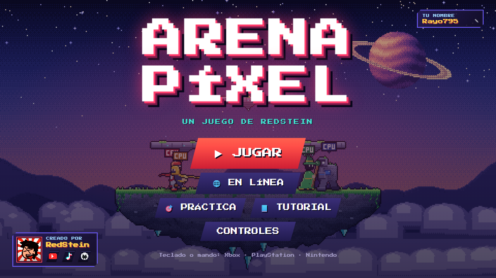

# Arena Píxel

**Un juego de lucha de plataformas en pixel art, hecho por [RedStein](https://www.youtube.com/@RedStein).**
Hasta 4 jugadores en el mismo teclado o con mandos, o en línea con tus amigos sin instalar nada.

### [▶ JUGAR AHORA](https://redsteinyt.github.io/arena-pixel/)


[](https://www.youtube.com/@RedStein)
[](https://www.tiktok.com/@redstein_la)
[](https://github.com/RedSteinYT)

</div>

---

## 🥊 De qué va

Saca a tus rivales del escenario. Cuanto más daño (%) llevan, más lejos salen volando con cada golpe. Gana el último que conserve vidas.

<p align="center">
  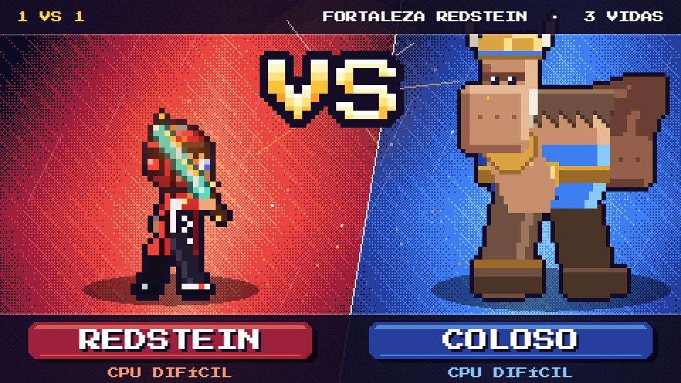
  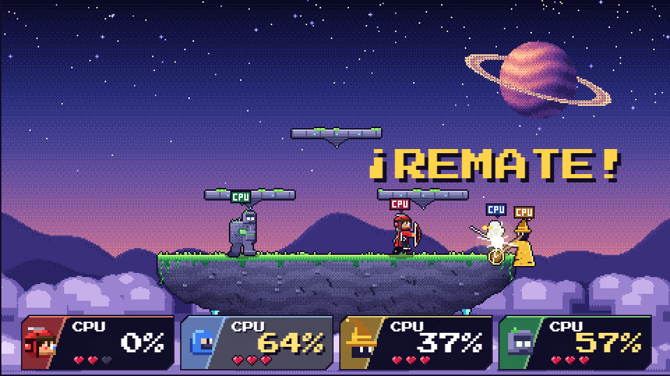
</p>

- **Combos de verdad.** Cadena de golpes 1-2-3, ataques que se encadenan subiendo de nivel y un **¡REMATE!** cuando cierras un combo con un ataque fuerte o un especial.
- **Ataques en DUPLA (Equipos).** Si tu compañero sujeta a un rival y tú también lo agarras, sale una **¡DUPLA!**. Algunas parejas tienen su propia técnica cinematográfica, la **¡¡¡DUPLA!!!**: la arena se detiene, la cámara se acerca y los dos la ejecutan juntos. Por ahora: **Espada Rúnica** (RedStein + Runa), **Terremoto** (Bloque + Coloso), **Burbuja Arcana** (Brisa + Runa), **Torbellino de Fuego** (Brisa + RedStein) y **Prensa Industrial** (Maniquí + Bloque). Solo sale si el rival ya tiene bastante daño, y quien la recibe tiene un respiro antes de la siguiente. Ojo: si golpean a quien está agarrando, suelta al rival.
- **Ataques RUBÍ.** Cada luchador tiene dos:
  - **Comeback de Rubí:** cuando tu daño llega al **100 %**, tu corazón **arde**. Pulsa **ATAQUE + ESPECIAL** en el suelo y sale un golpe brutal y espectacular, pero que **puede fallar**. Una vez por vida.
  - **Ultimate Ruby:** **concéntrate** manteniendo **ESCUDO + ESPECIAL** quieto unos 3 segundos (cualquier golpe te interrumpe). Luego, **ATAQUE + ESPECIAL**: si el golpe inicial acierta, **un corazón de rubí explota**, todo se congela y empieza la técnica. Una vez por vida, tiene prioridad sobre el Comeback y lo apaga hasta tu siguiente vida.
  - RedStein: **Tajo Carmesí** (embestida de fuego que frena en el borde) y **Lluvia Carmesí** (lanza al rival al cielo y le llueven flechas de rubí en llamas).
  - Brisa: **Ráfaga** (nueve patadas giratorias y un golpe de viento; hay que estar pegada al rival) y **Ojo del Huracán** (lo atrapa en un huracán, lo golpea desde todos los lados y cae en picada).
  - Runa: **Runa Súbita** (un círculo rúnico estalla a distancia fija delante de ella: hay que medir) y **Grimorio Prohibido** (sella al rival, abre un grimorio y del círculo rúnico del cielo cae un meteoro de runas).
  - Bloque: **Avalancha** (golpe al suelo y picos de roca a ambos lados; saltando se esquiva) y **Montaña Viviente** (absorbe rocas, se vuelve gigante y aplasta con el puño).
  - Maniquí: **Sobrecarga** (directo cargado de electricidad que aturde) y **Protocolo Final** (fija el objetivo, llama a un satélite y cae un láser orbital).
  - Coloso: **Pisotón Sísmico** (una onda sísmica recorre medio escenario por el suelo) y **Furia de la Montaña** (arranca una roca gigantesca del suelo y se la lanza al rival). Ninguno es KO directo, y se pueden quitar en las opciones de combate.
- **Filtro CRT opcional:** un interruptor en la portada pone el juego dentro de un televisor antiguo de madera, con líneas de barrido, antena, perillas y el papel tapiz de la casa de los abuelos.
- **Música y efectos con volumen separado,** desde el menú o en plena pausa.
- **14 objetos** que caen en plena pelea: armas que cambian tu ataque (espada láser, bláster, bumerán…), cosas para lanzar y poderes temporales.
- **Pantalla VS** con pullas antes de cada combate y música rock propia para cada arena.
- **Finales de película:** cámara lenta en el golpe final, zoom al ganador y animaciones de victoria y derrota propias de cada luchador. Si el ganador (o su compañero de equipo) ya había caído, vuelve por un portal para celebrarlo.
- **Opciones de combate:** vidas (1 a 9), tiempo (2, 3, 5 u 8 minutos, o sin límite) y objetos sí o no.
- **¡MUERTE SÚBITA!** Si se acaba el tiempo con empate en vidas: un solo corazón, todos al 300 % y el más mínimo roce te saca de la arena.
- **Resultados** con una tarjeta por luchador: su puesto, sus estadísticas y su animación de victoria o derrota.
- **Modo en línea** con código de sala: uno crea la sala, los demás escriben el código y a pelear.
- **PRÁCTICA y TUTORIAL** para aprender todo lo anterior paso a paso.

### ¡¡¡DUPLA!!!

<table>
  <tr>
    <td width="50%">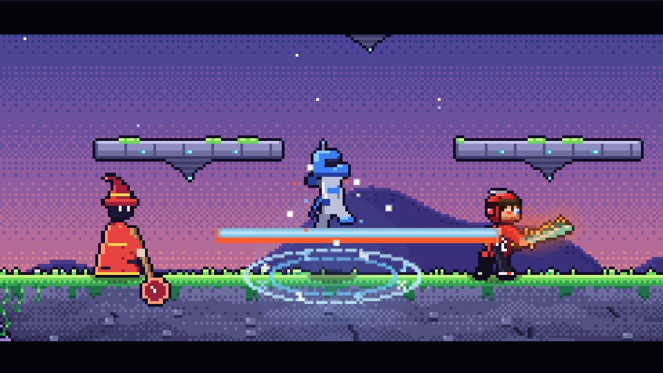<br><b>Espada Rúnica</b> · RedStein + Runa<br>Runa carga la espada con runas; RedStein cruza al rival de un tajo y el círculo rúnico estalla.</td>
    <td width="50%">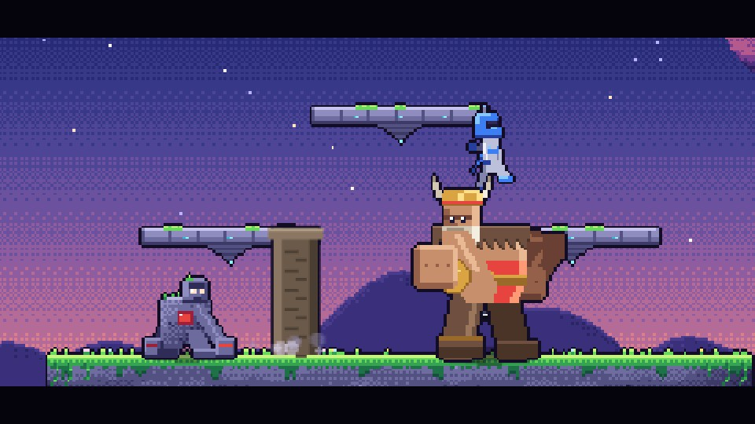<br><b>Terremoto</b> · Bloque + Coloso<br>Bloque levanta un pilar de roca y Coloso estrella contra él al rival.</td>
  </tr>
  <tr>
    <td>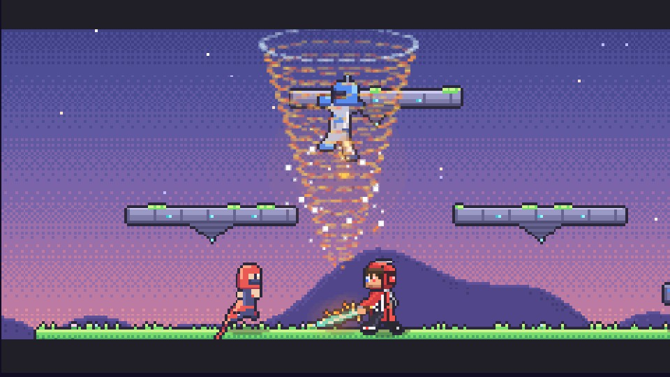<br><b>Torbellino de Fuego</b> · Brisa + RedStein<br>Brisa levanta un tornado y RedStein lo incendia con su espada.</td>
    <td>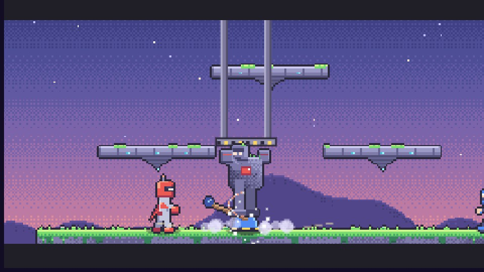<br><b>Prensa Industrial</b> · Maniquí + Bloque<br>Maniquí escanea al rival, Bloque cae encima como una prensa y Maniquí remata con un puño cohete.</td>
  </tr>
</table>

La quinta, **Burbuja Arcana** (Brisa + Runa), mejor descúbrela jugando.

## 🧙 Luchadores

| | Luchador | Estilo |
|---|---|---|
| 🔥 | **RedStein** | El luchador del canal. Espada de cristal en llamas, arco que se carga y golpes que queman. |
| 🌪️ | **Brisa** | Exploradora del viento. Ataques de varios golpes que se encadenan, triple salto y muy ligera. |
| 🔮 | **Runa** | Hechicera rúnica. Bastón largo, flota, se teletransporta y deja trampas. Mejor lejos que cerca. |
| 🪨 | **Bloque** | Gólem de roca. Lento y torpe en el aire, pero cada golpe pesa una tonelada. |
| 🤖 | **Maniquí** | Robot de entrenamiento. Equilibrado: ni muy rápido ni muy pesado. |
| ⛰️ | **Coloso** | Gigante de la montaña. Lentísimo, pero sus golpes ocupan medio escenario. No se le puede agarrar. |

## 🗺️ Arenas

<table>
  <tr>
    <td width="50%"><br><b>Isla Celeste</b><br>Isla flotante sobre un mar de nubes. La arena clásica, sin trucos.</td>
    <td width="50%">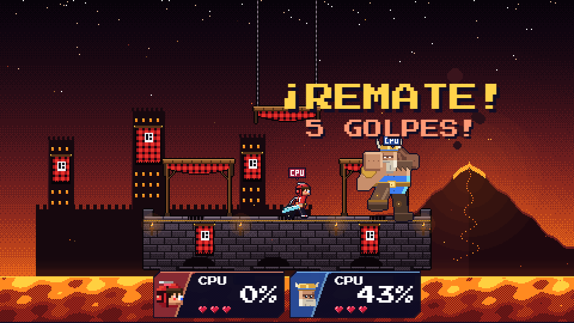<br><b>Fortaleza RedStein</b><br>El castillo del canal sobre un mar de lava. Las rejillas echan humo antes de lanzar géiseres de fuego.</td>
  </tr>
  <tr>
    <td>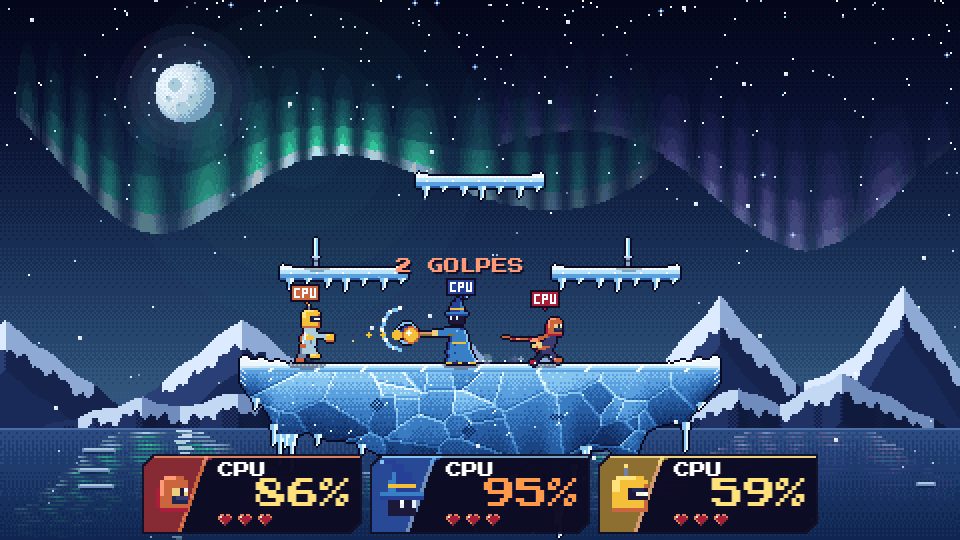<br><b>Glaciar Boreal</b><br>Isla de hielo bajo la aurora. El suelo es hielo pulido: se patina al frenar y al arrancar.</td>
    <td>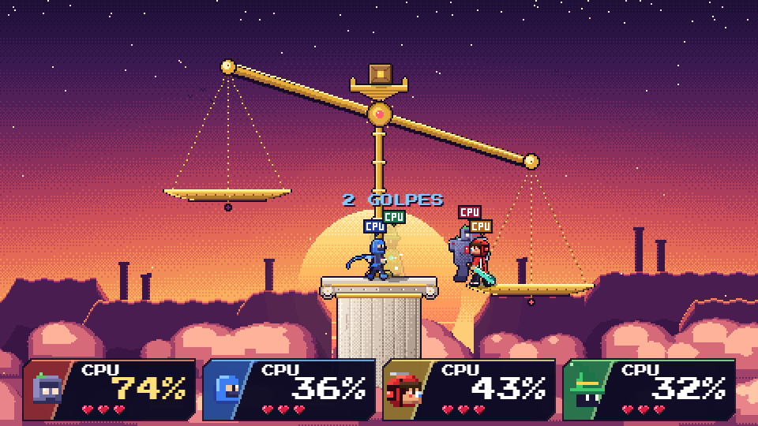<br><b>Templo del Equilibrio</b><br>Una balanza gigante: el plato con más peso baja y el otro sube. Coloso hunde su lado; Brisa apenas lo mueve.</td>
  </tr>
</table>

## 🎮 Modos

| Modo | |
|---|---|
| **1 contra 1** | El duelo clásico. |
| **Equipos** | Rojo contra azul: 2 contra 2, o incluso 3 contra 1 si alguien se atreve. |
| **Triple amenaza** | Tres luchadores, todos contra todos. |
| **Todos contra todos** | Cuatro luchadores, caos total. |
| **🌐 En línea** | Hasta 4 amigos, cada uno desde su casa, con un código de sala. |
| **🎯 Práctica** | Tú contra el Dummy, con vidas infinitas y tu mejor combo apuntado. |
| **📘 Tutorial** | Lecciones de básicos, combos, avanzados, objetos, ataques rubí y duplas, con tareas que te dicen qué pulsar. |

Cualquier hueco libre se puede llenar con una CPU en nivel fácil, medio o difícil.

<p align="center">
  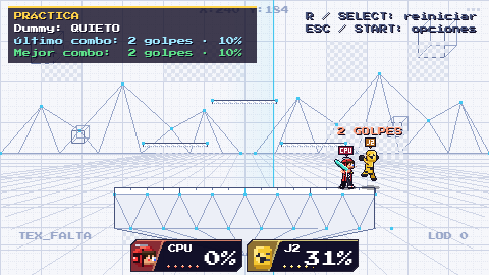<br>
  <sub>La Arena de entrenamiento: una arena que todavía no ha terminado de cargar.</sub>
</p>

## ⌨️ Controles

| Acción | Teclado 1 | Teclado 2 |
|---|---|---|
| Moverse | `W` `A` `S` `D` | Flechas |
| Saltar | `Espacio` | `Shift der.` / `Num 0` |
| Ataque | `J` / `F` | `.` / `Num 1` |
| Especial | `K` / `G` | `-` / `Num 2` |
| Escudo | `L` / `Shift izq.` | `Ctrl der.` / `Num 3` |
| Agarre / objeto | `Ñ` / `H` | `,` / `Num 4` |
| Ataque fuerte | `U` | `M` / `Num 5` |
| Ataque rubí | Ataque + Especial a la vez | Ataque + Especial a la vez |
| Concentrarse (Ultimate) | Escudo + Especial, mantenidos | Escudo + Especial, mantenidos |

**Mandos:** Xbox, PlayStation y Nintendo, sin configurar nada. Si el navegador no detecta tu mando, pulsa cualquier botón con la página abierta. Todos los botones están en **CONTROLES**, en el menú principal.

## 🌐 Jugar en línea

1. El anfitrión entra en **EN LÍNEA → CREAR SALA**, elige el **modo** y las **opciones de combate** (vidas, tiempo, objetos, rubí y cómo se elige la arena) y recibe un código de 5 letras (o el enlace, con **COPIAR ENLACE**).
2. Los demás entran en **EN LÍNEA**, escriben ese código y pulsan **ENTRAR**. La sala admite justo los jugadores del modo (2 en 1 contra 1, 3 en Triple amenaza, 4 en el resto).
3. Con la sala llena, el anfitrión pulsa **EMPEZAR** y se elige la arena:
   - **Elige el anfitrión:** todos ven su puntero y la arena que va mirando, en vivo.
   - **Votación:** cada uno deja su sello en la arena que quiere; gana la más votada y, si hay empate, se sortea entre las empatadas.
4. Cada uno elige su luchador y a pelear.

La conexión va directa entre vuestros navegadores (WebRTC con [PeerJS](https://peerjs.com/)): no hay servidor del juego ni cuentas. Pon tu nombre en el recuadro de arriba a la derecha para que tus amigos sepan quién eres.

## 🎬 El creador

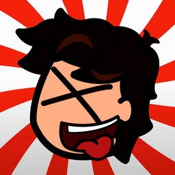

**RedStein** hace vídeos de videojuegos y este es su juego. Si te gusta, pásate por sus redes:

- ▶ **YouTube:** [youtube.com/@RedStein](https://www.youtube.com/@RedStein)
- ♪ **TikTok:** [tiktok.com/@redstein_la](https://www.tiktok.com/@redstein_la)
- 🐙 **GitHub:** [github.com/RedSteinYT](https://github.com/RedSteinYT)

<br clear="left">

## 🛠️ Para desarrolladores

Es HTML, CSS y JavaScript puro, sin dependencias de instalación ni paso de compilación. Todo el arte se dibuja con código y la música es un secuenciador de WebAudio.

```bash
git clone https://github.com/RedSteinYT/arena-pixel.git
cd arena-pixel
python -m http.server 8080
```

Después abre `http://localhost:8080`.

```
index.html          menú, estilos y orden de carga
js/core.js          lienzo, utilidades y efectos de sonido
js/fighter.js       física, estados y combos de los luchadores
js/game.js          la pelea: golpes, cámara, HUD y reglas
js/ai.js            las CPU
js/net.js           modo en línea (PeerJS, el anfitrión manda)
js/characters/      un archivo por luchador
js/stages/          un archivo por arena
js/items/           armas, lanzables y poderes
js/modes/           práctica y tutorial
```

---

<div align="center">

Hecho con 🔥 por **RedStein** · [Jugar](https://redsteinyt.github.io/arena-pixel/) · [YouTube](https://www.youtube.com/@RedStein) · [TikTok](https://www.tiktok.com/@redstein_la)

</div>
